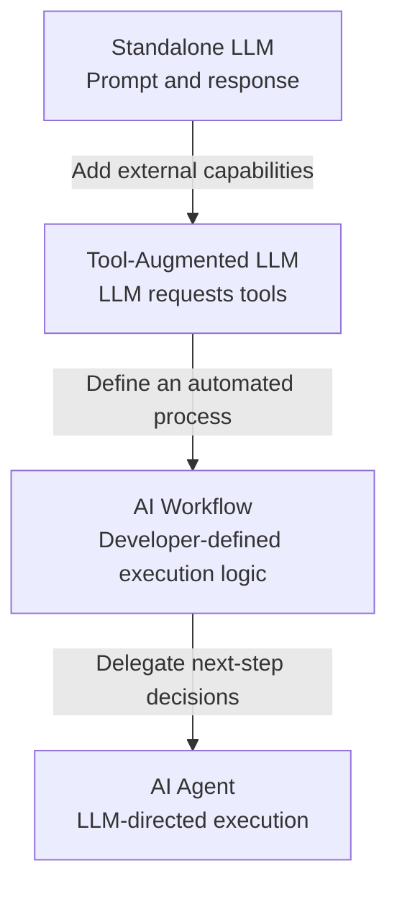
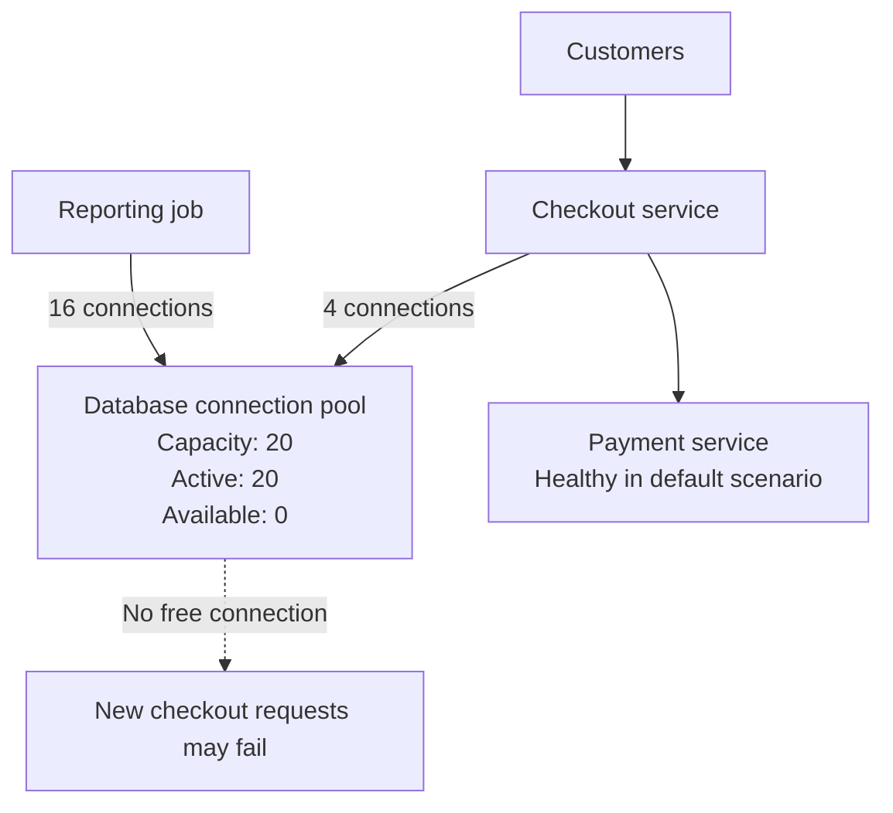
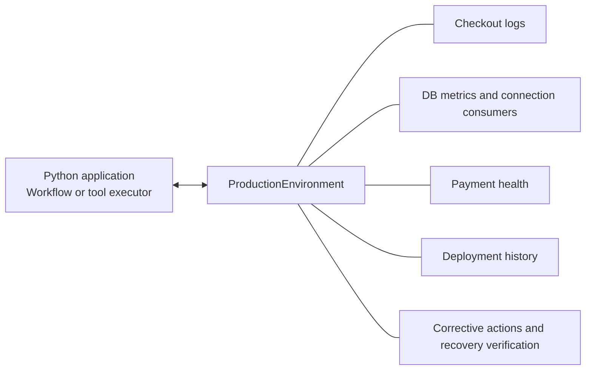
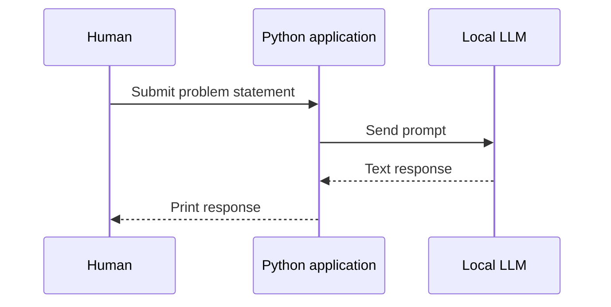
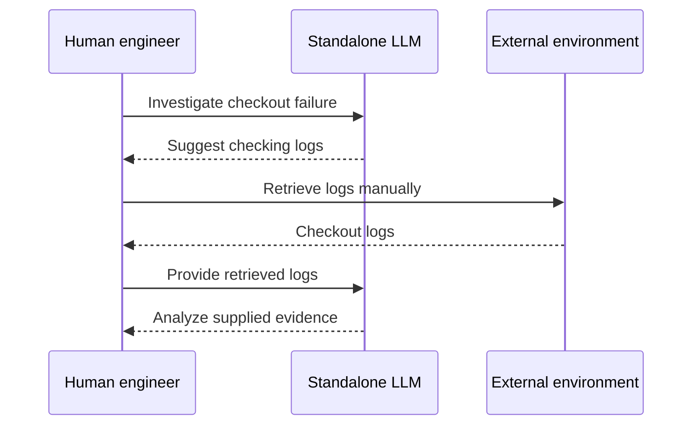
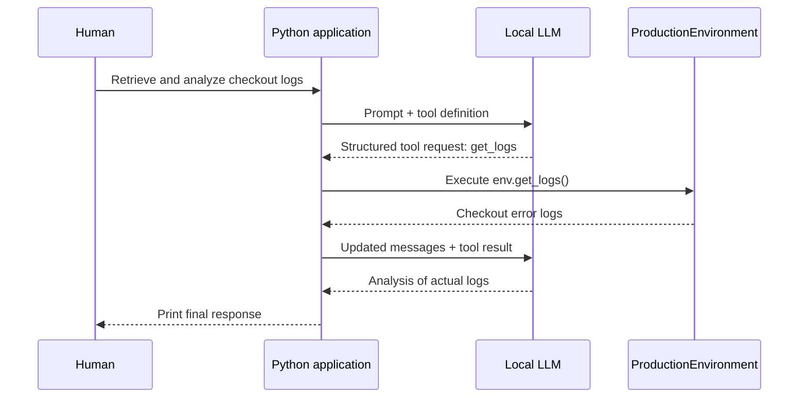
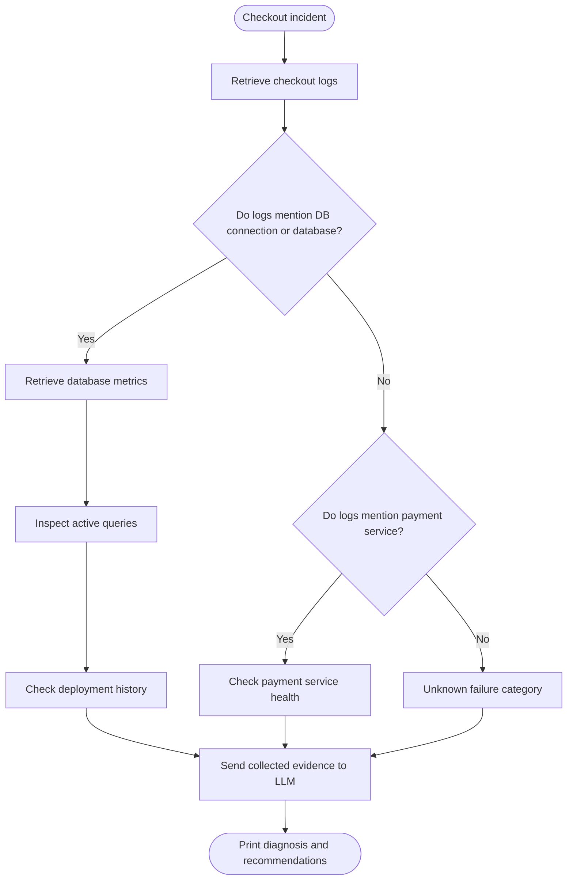
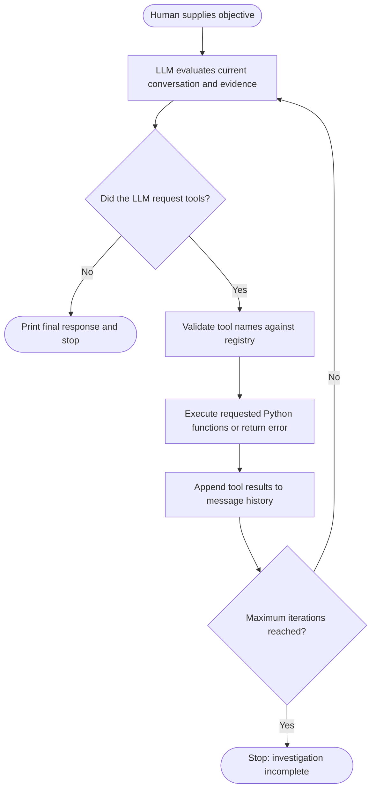
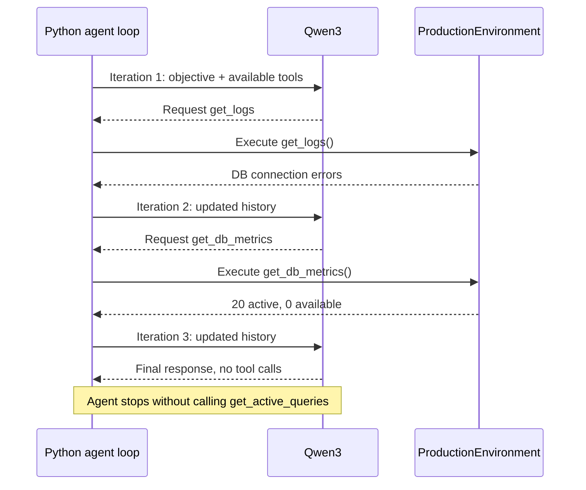
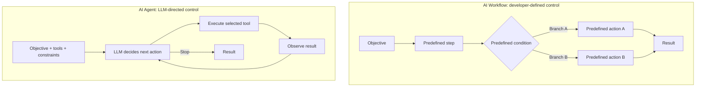

# AI Agent Demo: From Standalone LLMs to AI Agents

> A practical, problem-driven introduction to what makes an AI system agentic.
>
> **Techdose Engineering** | Python + Ollama + Qwen3:4b

## 1. Overview

This project demonstrates how an LLM-based application evolves from a simple prompt-response system into an AI agent that dynamically decides which tools to use in pursuit of an objective.

We implement four architectures using the same local language model and the same simulated production incident:

1. Standalone LLM
2. Tool-Augmented LLM
3. AI Workflow
4. AI Agent

The objective is to understand the difference between these architectures, not to build a real production monitoring system or train an LLM from scratch.



These are architectural patterns, not mutually exclusive product categories. An agent can use predefined workflows as tools, and a workflow can contain LLM calls, tool calls, loops, and even agentic components.

## 2. Problem Statement

An e-commerce application is experiencing a high failure rate in its checkout service. The objective is to investigate the incident, identify its root cause, recommend corrective action, and explain how recovery can be verified.

Possible causes include database connection exhaustion, payment service failure, or a recent deployment. Initially, the LLM receives only the problem description and must not be assumed to know the actual production state.

In our default simulated incident, a reporting job consumes 16 of the database's 20 available connections, while the checkout service occupies the remaining four. The connection pool is exhausted, causing new checkout requests that require a database connection to fail.



All logs, metrics, deployment records, and corrective actions in this repository are simulated in memory. No real database, payment service, logging platform, or production infrastructure is required.

## 3. Technology Stack

| Component | Purpose                                                         |
| --------- | --------------------------------------------------------------- |
| Python    | Application logic, tool execution, and orchestration            |
| Ollama    | Serves the local LLM through an HTTP API                        |
| Qwen3:4b  | The language model used in all four implementations             |
| Requests  | Python HTTP client used to communicate with Ollama              |
| JSON      | Represents structured tool requests, evidence, and tool results |

Ollama runs locally and exposes the chat endpoint at `http://localhost:11434/api/chat`. The Python scripts use this endpoint directly. No external LLM API key is required. An internet connection is needed for the initial downloads unless the required software and model are already installed.

The examples use `stream=False`, `think=False`, `temperature=0`, `num_ctx=4096`, and a 120-second HTTP timeout per request. The thinking setting depends on support in the installed Ollama/model version, and these settings do not guarantee identical model outputs across runs.

## 4. Project Structure

```text
ai-agent-demo/
├── README.md
├── environment.py
├── standalone_llm.py
├── tool_augmented_llm.py
├── ai_workflow.py
├── ai_agent.py
└── .venv/                  # Local Python virtual environment
```

| File                      | Responsibility                                                                       |
| ------------------------- | ------------------------------------------------------------------------------------ |
| `environment.py`        | Simulates the external production environment and exposes Python methods             |
| `standalone_llm.py`     | Sends a prompt to the LLM and prints the response                                    |
| `tool_augmented_llm.py` | Enables the LLM to request a log retrieval tool                                      |
| `ai_workflow.py`        | Executes predefined investigation steps and asks the LLM to analyze evidence         |
| `ai_agent.py`           | Lets the LLM dynamically select investigation tools through a bounded execution loop |

The human-assisted investigation is explained as a conceptual transition from the standalone LLM to tool augmentation; there is no separate Python file for that transition.

## 5. Getting Started

### Prerequisites

- Python 3 and pip
- Ollama installed and running
- The Qwen3:4b model
- A terminal (PowerShell on Windows is used below)
- VS Code, or any Python editor

Open PowerShell or the VS Code integrated terminal in the project directory.

### Step 1: Download the model

```powershell
ollama pull qwen3:4b
```

List locally installed models:

```powershell
ollama list
```

Check which models are currently loaded into memory:

```powershell
ollama ps
```

A model can be installed but not currently loaded. Ollama can load it when the first request arrives, so the first response may be slower than subsequent responses. If the Ollama service is not running, start the Ollama application (or run `ollama serve` in a separate terminal if appropriate for your setup).

### Step 2: Set up a Python virtual environment

For a fresh checkout, create a virtual environment:

```powershell
python -m venv .venv
```

Install the dependency inside that environment:

```powershell
.\.venv\Scripts\python.exe -m pip install requests
```

If the virtual environment already exists, reuse it. The commands below invoke its Python executable directly, so PowerShell activation is not required.

### Step 3: Run the implementations

Run these commands individually, in this order:

```powershell
.\.venv\Scripts\python.exe standalone_llm.py
.\.venv\Scripts\python.exe tool_augmented_llm.py
.\.venv\Scripts\python.exe ai_workflow.py
.\.venv\Scripts\python.exe ai_agent.py
```

The programs are independent. Each of the last three scripts creates a fresh simulated environment. The first script does not use that environment at all.

## 6. File 1 — `environment.py`

### Purpose

This file simulates the production environment with which the AI application interacts. In a real system, equivalent functions might retrieve logs from a logging service, query monitoring metrics, inspect database sessions, check a payment API, or trigger a controlled operational action.

Here, the `ProductionEnvironment` class implements those capabilities using ordinary Python methods and in-memory state. There is no LLM or AI logic inside this file.



### Constructor and state

```python
env = ProductionEnvironment(scenario="database", allow_actions=False)
```

| Attribute                 | Default database scenario | Payment scenario |
| ------------------------- | ------------------------: | ---------------: |
| `max_connections`       |                        20 |               20 |
| `checkout_connections`  |                         4 |                4 |
| `reporting_connections` |                        16 |                2 |
| `reporting_job_running` |                      True |             True |
| `payment_healthy`       |                      True |            False |
| `allow_actions`         |                     False |            False |

The default scenario is `database`. The `payment` scenario simulates an unavailable payment service instead of an exhausted database connection pool.

### Available methods

| Method                        | Category          | What it does                                                                                                       |
| ----------------------------- | ----------------- | ------------------------------------------------------------------------------------------------------------------ |
| `get_logs()`                | Investigation     | Returns checkout error logs based on the current simulated state                                                   |
| `get_db_metrics()`          | Investigation     | Returns maximum, active, and available database connections                                                        |
| `get_active_queries()`      | Investigation     | Returns connection usage by checkout and reporting services, with illustrative reporting duration                  |
| `get_payment_health()`      | Investigation     | Returns payment service health and an illustrative HTTP status (200 or 503)                                        |
| `get_deployment_history()`  | Investigation     | Returns a simulated deployment record for a new reporting task                                                     |
| `suspend_reporting_job()`   | Corrective action | Stops the simulated reporting job and releases its connections, if authorized                                      |
| `restart_payment_service()` | Corrective action | Marks the simulated payment service healthy, if authorized                                                         |
| `verify_health()`           | Verification      | Checks database connection availability and payment health, and returns a simulated checkout status and error rate |

The corrective action methods return `{"status": "approval_required"}` when `allow_actions` is false. This flag is an illustrative authorization mechanism, not a real approval workflow.

The implemented architectures are read-only investigations. They do not expose or execute the corrective action methods, and they recommend verification rather than actually invoking `verify_health()`.

### Example: retrieve checkout logs directly

```powershell
.\.venv\Scripts\python.exe -c "from environment import ProductionEnvironment; env = ProductionEnvironment(); print(env.get_logs())"
```

Expected output:

```text
['ERROR: DB connection timeout', 'ERROR: Unable to acquire database connection', 'ERROR: Checkout request failed']
```

### Example: retrieve database metrics

```python
from environment import ProductionEnvironment

env = ProductionEnvironment()
print(env.get_db_metrics())
```

Expected data (formatted as JSON for readability):

```json
{
    "max_connections": 20,
    "active_connections": 20,
    "available_connections": 0
}
```

The metric establishes that the connection pool is exhausted. To identify which service is consuming the connections, we need additional evidence from `get_active_queries()`.

**Implementation note:** Despite its name, `get_active_queries()` returns simplified service-level connection information rather than actual SQL statements or a real database session listing. The deployment record and error rates are illustrative, not measured telemetry.

## 7. File 2 — `standalone_llm.py`

### Architecture 1: Standalone LLM

A standalone LLM accepts an input prompt and generates a textual response using its learned knowledge and the information supplied in the prompt. It has no external tools in this implementation.



The script contains a predefined prompt describing the checkout failure. It constructs a payload containing the model name, user message, and generation settings, then sends the payload to Ollama using `requests.post()`.

### Execution flow

1. Define the local Ollama endpoint and model name.
2. Define the checkout failure prompt.
3. Construct the chat API payload.
4. Send an HTTP POST request to the local model.
5. Check the HTTP response for errors.
6. Extract the response text from `result["message"]["content"]`.
7. Print the response to the terminal.

The essential request-response mechanism is:

```python
response = requests.post(OLLAMA_URL, json=payload, timeout=120)
response.raise_for_status()
result = response.json()
print(result["message"]["content"])
```

### What happens if the LLM needs external information?

If the model recommends checking logs, a human must retrieve the logs and provide them to the LLM in another request. The current script performs only one LLM call; the additional manual steps below illustrate how a human would continue the investigation, not additional code executed by this file.



The human acts as the bridge between the LLM and the external environment.

### Run

```powershell
.\.venv\Scripts\python.exe standalone_llm.py
```

Illustrative output (not an exact model transcript):

```text
--- Standalone LLM Response ---

Possible causes include database connection issues, an unavailable
payment service, or a recent deployment. Inspect application logs
and service metrics to narrow down the cause.
```

**Limitation:** The model cannot independently verify the actual cause. Any failure percentages, logs, or findings invented by the model without supplied evidence should be treated as unverified, not as production observations.

## 8. File 3 — `tool_augmented_llm.py`

### Architecture 2: Tool-Augmented LLM

Tool augmentation extends the capabilities of an LLM by allowing it to request external operations through a programmatic interface. Examples include web search, database queries, calculations, and log retrieval.

In this implementation, we expose exactly one tool: `get_logs()`.



### Key components

**1. Tool definition:** The `tools` list tells the LLM which operation is available, what it does, and which input parameters it accepts.

```json
{
    "type": "function",
    "function": {
        "name": "get_logs",
        "description": "Retrieve checkout service logs",
        "parameters": {
            "type": "object",
            "properties": {},
            "required": []
        }
    }
}
```

This tool requires no arguments. The definition is a schema that describes the capability; it is not the Python implementation itself.

**2. User message:** The user instructs the LLM to retrieve checkout logs and explain what they indicate, without claiming an unverified root cause.

**3. `call_llm(messages, tools=None)`:** Sends messages to Ollama and, when supplied, includes the tool definitions in the request. It returns the model's complete message, which can contain both text and structured tool calls.

**4. Tool-call handling:** The application reads `message.get("tool_calls") or []`. If the model requested `get_logs`, the Python application executes `env.get_logs()`. An unknown tool produces an error result. If the LLM does not request a tool, the script simply prints its textual response.

An illustrative tool-call response looks like this (only relevant fields shown):

```json
{
    "tool_calls": [
        {
            "function": {
                "name": "get_logs",
                "arguments": {}
            }
        }
    ]
}
```

**5. Tool result:** The Python application prints the retrieved data, serializes it with `json.dumps()`, and appends it to the conversation history with the role `tool` and the tool name.

**6. Final LLM call:** The application sends the updated message history to the LLM again, this time without supplying tool definitions. The model analyzes the logs and generates its final response.

### Run

```powershell
.\.venv\Scripts\python.exe tool_augmented_llm.py
```

Illustrative output:

```text
--- Sending request to LLM ---

[LLM requested tool]: get_logs

[Tool output]
[
    "ERROR: DB connection timeout",
    "ERROR: Unable to acquire database connection",
    "ERROR: Checkout request failed"
]

--- Tool-Augmented LLM Response ---

The retrieved logs indicate that checkout requests are failing
because the service is unable to acquire a database connection.
Additional database metrics are required to determine why.
```

### What has changed?

The human no longer needs to manually retrieve the logs and paste them into the LLM. The model requests the tool, the Python application executes it, and the model interprets the result.

`tools` means the capabilities offered to the model. `tool_calls` means the operations the model actually requests. An available tool is not guaranteed to be called.

**Limitation of this demo:** We expose just one tool and support one round of tool execution. The program does not autonomously conduct the entire multi-step investigation. Tool-augmented systems can be more sophisticated than this example; the limitation belongs to this implementation, not to tool calling in general.

## 9. File 4 — `ai_workflow.py`

### Architecture 3: AI Workflow

An AI workflow orchestrates ordinary code, tools, conditional logic, and LLM calls according to a process defined by the developer.

Here, we automate the entire predefined investigation rather than asking a human to direct each step. Python retrieves and examines the logs, selects the appropriate branch, collects the evidence, and finally asks the LLM to analyze it.



### Key components

**1. Environment initialization:** Creates the default database failure scenario using `ProductionEnvironment(scenario="database")`.

**2. Evidence collection:** Directly invokes `env.get_logs()` and stores the returned logs in the `evidence` dictionary. No LLM call is required for this step.

**3. Conditional routing:** Converts the logs into lowercase text and checks for known error categories using Python `if` / `elif` / `else` statements.

| Branch           | Predefined operations                                                     |
| ---------------- | ------------------------------------------------------------------------- |
| Database failure | Retrieve DB metrics, inspect active queries, and check deployment history |
| Payment failure  | Retrieve payment service health                                           |
| Unknown category | Retain the collected logs and report that the category is unknown         |

**4. LLM analysis:** The `call_llm(prompt)` helper sends the collected evidence to Qwen3. The model is instructed to identify the root cause, explain the failure, recommend a corrective action, and suggest verification steps based only on the evidence.

**5. Final output:** Prints the LLM's report. The script does not execute the recommended corrective actions.

### Run

```powershell
.\.venv\Scripts\python.exe ai_workflow.py
```

Illustrative output:

```text
--- AI Workflow Started ---

[Step 1] Retrieving checkout logs
[Step 2] Identifying failure category
Database investigation branch selected

[Step 3] Retrieving database metrics
[Step 4] Inspecting active queries
[Step 5] Checking deployment history
[Final Step] Analyzing collected evidence

--- AI Workflow Response ---

Root cause: The reporting job is holding 16 of 20 database
connections. The checkout service occupies the remaining four,
leaving no free connections for additional checkout requests.

Recommended action: Suspend or optimize the reporting job.
Verification: Check connection availability and checkout error rate.

--- AI Workflow Completed ---
```

### What has changed?

The entire sequence of investigation steps and the routing conditions are defined by the developer. The LLM performs the final analysis, rather than deciding which tool should be executed at each intermediate step.

In this implementation, the workflow uses direct Python method calls, not LLM-generated tool calls, during evidence collection. There is one LLM request at the end.

**Limitation of this demo:** The investigation only collects additional evidence for the explicitly implemented database and payment branches. Other failures reach the fallback branch. Workflows in general can also have loops, retries, parallel tasks, dynamic inputs, and quality checks; those mechanisms operate within developer-defined orchestration logic.

## 10. File 5 — `ai_agent.py`

### Architecture 4: AI Agent

An AI agent is a system that uses an LLM as a decision-making engine to dynamically determine the next action in pursuit of an objective. The developer defines the objective, available capabilities, and constraints, rather than prescribing every investigation step.

In this implementation, Qwen3 decides which investigation tools to call and when to stop. Python provides the execution loop and executes the chosen functions.



### Key components

**1. Tool registry:** A mapping from tool names to callable Python methods. It restricts the tools the application will execute.

```python
tool_registry = {
    "get_logs": env.get_logs,
    "get_db_metrics": env.get_db_metrics,
    "get_active_queries": env.get_active_queries,
    "get_deployment_history": env.get_deployment_history,
    "get_payment_health": env.get_payment_health
}
```

| Registered tool            | What the agent can learn                          |
| -------------------------- | ------------------------------------------------- |
| `get_logs`               | Checkout error messages                           |
| `get_db_metrics`         | Database connection pool utilization              |
| `get_active_queries`     | Which services are consuming database connections |
| `get_deployment_history` | Information about simulated recent deployments    |
| `get_payment_health`     | Whether the payment service is healthy            |

All five registered tools are read-only. The corrective action and recovery verification methods in `environment.py` are not registered for this agent.

**2. Tool descriptions:** Explain the purpose of each tool to the LLM. The script converts these descriptions into the JSON-compatible function schemas sent to Ollama. The registry is used by Python for execution; the tool schemas are used by the model for deciding what to request.

**3. System instructions and user objective:** The system message tells the model to investigate the incident, use available tools, avoid unnecessary calls, base conclusions on evidence, and produce a diagnosis and recommendations. The user message supplies the checkout failure problem.

**4. `call_llm(messages)`:** Sends the current conversation history and all five tool definitions to Qwen3 on each iteration. The complete response message is returned to Python.

**5. Agent loop:** The code uses `MAX_ITERATIONS = 10` to bound the number of LLM consultation rounds.

In each iteration:

- Call the LLM with the current message history.
- Append the assistant message to the history.
- Inspect the returned `tool_calls` list.
- If no tool call is requested, print the final response and stop.
- Otherwise, validate each requested tool name and execute its corresponding Python method.
- Serialize the tool results and append them to the conversation history.
- Consult the LLM again on the next iteration, unless the limit has been reached.

The central tool execution statement is:

```python
result = tool_registry[tool_name]()
```

The application executes the selected function. The LLM does not execute arbitrary Python code. If a tool is unknown or execution raises an exception, the program returns an error result for the model to consider.

Tool results are returned to the model through the message history:

```python
messages.append({
    "role": "tool",
    "tool_name": tool_name,
    "content": json.dumps(result)
})
```

`json.dumps()` converts the Python result into a JSON-formatted string. The next LLM request receives this string along with the earlier conversation and tool calls.

### An example agent trajectory

During the demonstration, the agent first requested the checkout logs, then requested database metrics, and finally produced a response in its third iteration.



This sequence is not hardcoded. The model could choose a different order, request multiple tools in one iteration, investigate the payment service, or stop earlier. The ten-iteration limit bounds LLM requests, not the total number of individual tool executions.

### Run

```powershell
.\.venv\Scripts\python.exe ai_agent.py
```

Illustrative output based on the demonstrated run (not an exact transcript):

```text
--- AI Agent Started ---

--- Iteration 1 ---
Consulting LLM...
[Agent selected tool]: get_logs
[Tool output]
["ERROR: DB connection timeout", ...]

--- Iteration 2 ---
Consulting LLM...
[Agent selected tool]: get_db_metrics
[Tool output]
{
    "max_connections": 20,
    "active_connections": 20,
    "available_connections": 0
}

--- Iteration 3 ---
Consulting LLM...

--- AI Agent Final Response ---

The database connection pool is exhausted, causing checkout failures.
Further investigation may be needed to identify why the pool is full.

--- AI Agent Completed ---
```

### Stopping conditions and practical limitations

The agent stops if the model returns no tool calls or if `MAX_ITERATIONS` is reached. Reaching the iteration limit without a final response prints an incomplete-investigation message. The code does not independently verify the quality or completeness of the final answer.

In the demonstrated run, the agent discovered database connection exhaustion but did not inspect the active queries or deployment history. It therefore did not establish that the reporting job was responsible. The predefined workflow collected more complete evidence in this particular example.

This is a useful lesson: autonomy does not guarantee correctness, thoroughness, or better results than a well-designed workflow. More reliable agents may require evidence validation, stronger tool-use instructions, evaluation, retry policies, and explicit human approval for high-impact operations.

## 11. Architecture Comparison

| Aspect                       | Standalone LLM       | Tool-Augmented LLM                            | AI Workflow                             | AI Agent                                |
| ---------------------------- | -------------------- | --------------------------------------------- | --------------------------------------- | --------------------------------------- |
| External data access         | None in the script   | Through requested tool calls                  | Through predefined Python calls         | Through dynamically selected tools      |
| Who determines next steps?   | Human                | Human directs the task; LLM requests the tool | Developer-defined control logic         | LLM at runtime, within constraints      |
| Tools used in this demo      | None                 | `get_logs`                                  | Methods selected by predefined branches | Five registered investigation tools     |
| LLM requests in this demo    | 1                    | 1 or 2                                        | 1                                       | Up to 10                                |
| Control flow                 | Prompt-response      | One tool-call round                           | Predefined conditional branches         | Iterative decision and observation loop |
| Final diagnosis              | Based on prompt only | Based on retrieved logs, if called            | Based on workflow-collected evidence    | Based on agent-selected evidence        |
| Corrective actions executed? | No                   | No                                            | No                                      | No                                      |
| Recovery actually verified?  | No                   | No                                            | No                                      | No                                      |

### Workflow vs. Agent: the fundamental difference



Both can take actions, branch, iterate, and use LLMs. Both may follow the exact same execution sequence. The essential difference is whether the next-step decisions are prescribed by the developer's orchestration logic or delegated to the LLM dynamically.

## 12. Try It Yourself

After running all four scripts, try these experiments:

1. Change `scenario="database"` to `scenario="payment"` in `ai_workflow.py` and `ai_agent.py`. Observe whether the workflow selects the expected branch and which tools the agent requests.
2. Modify the user prompt in `tool_augmented_llm.py` to ask a conceptual question instead of retrieving logs. Check whether the model responds without a tool call.
3. Change `MAX_ITERATIONS` in `ai_agent.py` to `2` and observe what happens if the agent has not produced a final response by the limit.
4. Strengthen the agent's system instructions to require evidence about the consumers of database connections before attributing an exhausted connection pool to a specific service. Compare its investigation with the original run.

These experiments demonstrate how tool availability, orchestration, model behavior, and runtime limits influence the result. Restore the original settings before comparing the default examples.

## 13. Troubleshooting

| Issue                                               | What to check                                                                                                   |
| --------------------------------------------------- | --------------------------------------------------------------------------------------------------------------- |
| `ModuleNotFoundError: No module named 'requests'` | Install `requests` using the same Python interpreter that executes the script                                 |
| Connection refused at port 11434                    | Ensure Ollama is running locally                                                                                |
| Model not found                                     | Run `ollama list` and download `qwen3:4b` if necessary                                                      |
| Slow or delayed output                              | The first call may load the model; streaming is disabled, so the program waits for the full response            |
| HTTP timeout                                        | Check Ollama responsiveness and model speed; the code sets a 120-second timeout per request                     |
| No tool call requested                              | Inspect the prompt, tool descriptions, model behavior, and tool-calling support                                 |
| Agent stops too early                               | Check the collected evidence; the model decides to stop, and the demo has no independent completeness validator |
| Maximum iterations reached                          | The run is incomplete; investigate repeated or unnecessary tool calls and refine the stopping policy            |

## 14. Key Takeaways

- **Standalone LLM:** Provides reasoning and text generation based on the input it receives.
- **Tool augmentation:** Gives the LLM external capabilities through a programmatic interface.
- **AI workflow:** Defines a process for orchestrating those capabilities to achieve an objective.
- **AI agent:** Delegates next-step decisions to the LLM so the execution path can be determined dynamically from observations.

The same underlying language model can be used across these architectures. What changes is the application architecture, access to external tools, and who controls the execution process.

> What makes an AI system agentic is its ability to dynamically decide what to do next in pursuit of an objective, based on observations and within defined boundaries.

## 15. Further Reading

- [Ollama documentation](https://docs.ollama.com/)
- [Ollama tool calling](https://docs.ollama.com/capabilities/tool-calling)
- [Qwen3 model on Ollama](https://ollama.com/library/qwen3)
- [Python virtual environments](https://docs.python.org/3/library/venv.html)

---

**Techdose Engineering** — Learning AI engineering through practical system design and implementation.
